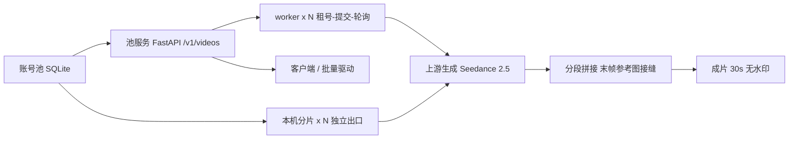

# seedance-pool-orchestrator

> 面向 Seedance / Pippit 的账号池调度与批量出片系统：账号池 + OpenAI 兼容 `/v1/videos` 接口 + 多出口分段拼接流水线。

**English tl;dr** — An OpenAI-compatible video generation gateway backed by a pool of
Seedance accounts. It schedules jobs across dozens of workers, stitches short segments into a
strict 30-second clip with seam continuity, accounts every credit, and classifies failures so
throttled runs cost nothing.

---

## 目录

- [它解决什么问题](#它解决什么问题)
- [核心特性](#核心特性)
- [架构](#架构)
- [目录结构](#目录结构)
- [快速开始](#快速开始)
- [HTTP API](#http-api)
- [模型与计费（实测）](#模型与计费实测)
- [画幅代码表（实测）](#画幅代码表实测)
- [关键机制](#关键机制)
- [配置项](#配置项)
- [运维手册](#运维手册)
- [实测数据](#实测数据)
- [免责声明](#免责声明)
- [License](#license)

---

## 它解决什么问题

上游视频模型（Seedance 2.5 / Dreamina）单次生成有**时长不可控**的问题：请求 15 秒可能只回
3.8 秒，也可能回 20 秒；平台还有按账号维度的生成配额闸门（`capflow`）。

本项目把「一堆各自只有几十到几百分额度的账号」变成一个**稳定的视频 API**：

1. **账号池**：SQLite 保存 uid / cookies / workspace / 余额 / 状态 / 冷却时间；
2. **调度**：worker 原子租号 → 提交 → 轮询 → 下载 → 回写余额；
3. **严格时长**：单段不够就多段拼接，用**上一段最后一帧**作为下一段首帧参考，保证接缝不跳切；
4. **成本可控**：按「实际产出秒数 × 4 分」记账，失败（capflow / 13002 / 超时）**0 扣费**；
5. **多出口**：同一套池子可以挂在本机、代理出口、远端服务器并行跑，出口 IP 之间互不干扰。

## 核心特性

| 能力 | 说明 |
|---|---|
| OpenAI 兼容 | `POST /v1/videos`、`GET /v1/videos/{id}`、`GET /v1/videos/{id}/content`，现有 SDK 直接可用 |
| 账号池 | 原子租约、余额回写、失败冷却、断线恢复（重启后 `running → queued`） |
| 分段拼接 | 目标 30s，单段上限 15s，自动裁切 + concat，产出 30.0x 秒 |
| 接缝连续 | 抽取上一段末帧 → 上传为参考图 → 下一段以该帧为首帧继续 |
| 中途换号 | 余额耗尽时**不判失败**，换新号继续拍（`handoff`），避免半成品被丢弃 |
| 余额封顶 | 请求秒数 ≤ `(余额 - 5) / 5.4`，防止产出超预期造成透支 |
| 失败分类 | 限流/超时类失败不扣分，直接换号重试 |
| 多出口舰队 | 每个出口一个分片进程，心跳 + 看门狗自动重启 |
| 运维工具 | 池统计、媒体清理、孤儿租约回收、模型/画幅/成本探针 |

## 架构



三种部署形态可以混跑：

| 形态 | 出口 | 说明 |
|---|---|---|
| 池服务器 | 服务器 IP | 主力，`SPO_MAX_WORKERS` 控制并发 |
| 本机分片 | 本机 / 代理 | `src/client/fleet.py` 起多个分片 |
| 单次探针 | 任意 | `src/tools/probe_*.py`，用于测成本 / 画幅 / 单段 |

## 目录结构

```
.
├── src/
│   ├── server/               # 池服务（FastAPI）
│   │   ├── app.py            # HTTP 路由：/v1/*、/admin/*
│   │   ├── worker.py         # 调度与多段拼接
│   │   ├── db.py             # SQLite schema / 租约 / 任务
│   │   ├── pippit.py         # 上游账号客户端（纯 HTTP）
│   │   ├── refs.py           # 参考素材上传链（STS + SigV4）
│   │   └── _pp_http.py       # 签名、下载、ffprobe 封装
│   ├── client/
│   │   ├── batch_worker.py   # 本机分片 worker（租号 → 出片）
│   │   ├── batch_driver.py   # 批量驱动（提交 + 下载）
│   │   └── fleet.py          # 多分片守护（心跳 + 看门狗）
│   ├── tools/                # 运维与探针
│   │   ├── pool_stats.py     # 池快照 CSV
│   │   ├── media_reaper.py   # 媒体保留期清理
│   │   ├── release_orphans.py# 回收孤儿租约
│   │   └── probe_*.py        # 模型成本 / 画幅 / 单段 / 领分探针
│   └── accounts/
│       └── claim_credits.py  # 对已有 cookie 领取一次性奖励额度
├── docs/
│   ├── PROTOCOL.md           # 完整协议逆向（端点、参数、错误码、计费）
│   ├── API.md                # HTTP API 参考
│   └── RUNBOOK.md            # 运维手册（重启顺序、故障排查）
├── requirements.txt
└── .env.example
```

## 快速开始

### 1) 安装

```bash
git clone https://github.com/Potato-Allens/seedance-pool-orchestrator.git
cd seedance-pool-orchestrator
python -m venv .venv && . .venv/bin/activate    # Windows: .venv\Scripts\activate
pip install -r requirements.txt
```

系统需要 `ffmpeg` / `ffprobe`。

### 2) 配置

```bash
cp .env.example .env
# 至少填 SPO_ADMIN_TOKEN 和一个池 API key
```

### 3) 起服务

```bash
cd src/server
SPO_PORT=8788 SPO_MAX_WORKERS=8 SPO_ADMIN_TOKEN=change-me python app.py
curl -s localhost:8788/healthz
```

### 4) 导入账号

```bash
curl -s -X POST localhost:8788/admin/accounts/import \
  -H "X-Admin-Token: change-me" -H "Content-Type: application/json" \
  -d '[{"uid":"10001","cookies":{"sid":"..."},"ports":[0]}]'
```

### 5) 发一个任务

```bash
curl -s -X POST localhost:8788/v1/videos \
  -H "Authorization: Bearer $POOL_API_KEY" -H "Content-Type: application/json" \
  -d '{"prompt":"A slow dolly shot through a rainy neon alley","seconds":30,"size":"1080x1920"}'
```

### 6) 本机分片（可选）

```bash
python src/client/fleet.py
python src/client/batch_worker.py --workers 8 --limit 40 --ports 0
```

## HTTP API

| 方法 | 路径 | 说明 |
|---|---|---|
| GET | `/healthz` | 健康检查 |
| GET | `/v1/models` | 模型别名列表 |
| POST | `/v1/videos` | 创建任务（prompt / seconds / size / ratio / refs） |
| GET | `/v1/videos/{id}` | 查询状态、进度、错误 |
| GET | `/v1/videos/{id}/content` | 下载成片（mp4） |
| GET | `/v1/videos` | 列表 |
| POST | `/v1/videos/{id}/cancel` | 取消 |
| POST | `/admin/keys` | 建 API key |
| GET | `/admin/accounts` | 账号池快照 |
| POST | `/admin/accounts/import` | 导入账号（自动 bootstrap + 读余额） |
| POST | `/admin/accounts/refresh` | 刷新余额 |
| GET | `/admin/jobs` | 任务与事件 |

完整字段见 [docs/API.md](docs/API.md)。

## 模型与计费（实测）

**计费公式：扣分 = 实际产出秒数 × 4**（与请求秒数无关；失败任务 0 扣费）。

| 模型 | 分辨率 | 产出/请求 | 分/秒 | 结论 |
|---|---|---|---|---|
| Seedance_2.5 | 720p wire | 15.000s / 15s | **4.00** | 主力，性价比最优 |
| Seedance_2.0_fast | 720p | 15.000s / 15s | **4.00** | 同价 |
| seedance_1.0 | 720p | 15.000s / 15s | **4.00** | 同价 |
| Seedance_2.0_mini_lite | 720p | 7.767s / 15s | 3.99 | 同价（描述里的 7 credits/s 不实） |
| Seedance_2.0 | 720p | 7.600s / 15s | 7.37 | 更贵，不建议 |
| Seedance_2.0_mini | 720p | 6.900s / 15s | 10.14 | 最贵 |
| Seedance_2.5 | 480p wire | 11.967s / 15s | 6.18 | 480p 反而更贵 |

> 结论：**4 分/秒 是地板价**，换模型省不了钱；2.5@720p 是唯一理性选择。
> 480p wire 不会降低成本，也不会降低输出分辨率（仍为 1080×1920）。

## 画幅代码表（实测）

用真实输出帧尺寸反推（`src/tools/probe_ratio.py`）：

| 代码 | 输出 | 画幅 |
|---|---|---|
| 3 | 1080×1920 | 9:16 |
| 2 | 1920×1080 | 16:9 |
| 4 | 1440×1080 | 4:3 |
| 5 | 1080×1440 | 3:4 |
| 6 | 1080×1080 | 1:1 |
| 1 / 13 | — | 无效（13002） |

```python
RATIO_CODE = {"9:16": 3, "16:9": 2, "1:1": 6, "4:3": 4, "3:4": 5}
```

## 关键机制

### 1) 分段拼接与严格 30s

```
need = 目标秒数
while 已生成 < need - 容差 and 段数 < 6:
    段长 = min(15, need - 已生成)
    生成该段（第 2 段起用上一段末帧作参考图）
    d = ffprobe(段)
    取 min(d, 剩余需求)，多余部分裁掉
concat(所有段) → 成片，校验 >= 20s
```

实测连续 18 条成片全部落在 **30.046 ~ 30.079s**。

### 2) 账号池与「搁浅积分」

每个账号额度固定（如 340 分），一条 30s 成片约 120 分。若租号阈值写死 120，
余额 80~119 的账号就永远租不到，全池会有 **2/3 的积分闲置**。

本项目内置三层修复：

1. `SPO_MIN_CREDIT`（默认 80）——把门槛降下来；
2. `handoff`——余额 <60 时**不算失败**地换号续拍，而不是中断丢弃半成品；
3. 余额封顶公式 `seg_len ≤ (credit - 5) / 5.4`——防止「请求 15s 却产出 20s」造成透支。

### 3) 失败分类（决定是否扣费）

| 症状 | 归类 | 扣费 |
|---|---|---|
| `capflow ... over limit, force terminate` | 上游配额闸门 | 0 |
| `13002 ... request_timeout / not found workspace` | 规划超时 / 空间失效 | 0 |
| `GetMaterial ... request timeout` | 素材服务超时 | 0 |
| 产出过短（0.8~4s） | 模型提前收尾 | 按实际秒数 |
| `asset not found` | 换号后参考图失效 | 0（需重传） |

### 4) 换号必须重传参考图

参考素材的 asset id 绑定在账号的 workspace 上。换号后继续复用旧 parts，就会报
`convert path ... to asset ID failed: code=1, message=[asset not found]`。
本项目在换号后自动重新上传接缝帧，这是稳定出片的关键修补。

## 配置项

| 变量 | 默认 | 说明 |
|---|---|---|
| `SPO_PORT` / `SPO_HOST` | 8788 / 0.0.0.0 | 监听地址 |
| `SPO_MAX_WORKERS` | 8 | 并发 worker 数 |
| `SPO_PER_KEY_CONCURRENCY` | 16 | 单 key 并发上限 |
| `SPO_ADMIN_TOKEN` | 随机生成 | `/admin/*` 鉴权 |
| `SPO_MAX_SECONDS` | 30 | 单任务最大秒数 |
| `SPO_XFADE` | 0 | 接缝交叉淡入时长（0 = 硬切） |
| `SPO_25_SEAM` | 1 | 2.5 车道是否启用末帧参考 |
| `SPO_AUTO_CLAIM` | 0 | 余额低时自动领取奖励任务 |
| `SPO_MIN_CREDIT` | 80 | 本机分片租号门槛 |
| `PP_WIRE_RES` | 720p | 提交时的 video_resolution |
| `POOL_HOST` / `POOL_SSH_*` | — | 分片访问池服务器的 SSH 参数 |
| `POOL_ADMIN_TOKEN` | — | 分片读取池管理接口 |
| `POOL_API_KEY` | — | 批量驱动调用池 API |

## 运维手册

见 [docs/RUNBOOK.md](docs/RUNBOOK.md)：重启顺序、双租预防、看门狗、常见故障对照表。

三条铁律：

1. **重启池服务前先停本机分片**，否则 `busy` 账号会被刷回 `ready` 造成双租；
2. 长驻进程用计划任务 / systemd，不要用交互式进程（会被回收）；
3. 强杀分片会漏租约，用 `src/tools/release_orphans.py` 清（只清没被 running/queued 引用的）。

## 实测数据

同一天单机 + 单服务器（44 worker）的观测，供容量规划参考：

| 指标 | 数值 |
|---|---|
| 单段产出均值 | 12.2s（58% ≥14s） |
| 单段耗时 | 220 ~ 1858s（随平台负载波动） |
| 一条 30s 成片成本 | 115 ~ 175 分（均值 122） |
| 单账号 340 分可产出 | 2 条 30s + 1 个首段（阈值 80 时） |
| 平台高峰时单任务耗时 | 1300 ~ 2600s |

## 免责声明

本项目仅用于**协议研究与流水线工程**的技术演示。使用者需自行确保账号获取方式、
生成内容的版权与合规性，以及目标平台服务条款的遵守。作者不对任何滥用行为或
由此产生的后果负责。

## License

[Apache-2.0](LICENSE)
